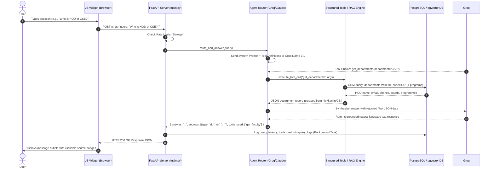

# Technical Stack & System Architecture Guide: NIT RKL Bot

**System Name:** NIT Rourkela Website Chatbot (NIT RKL Bot)  
**Version:** 2.0  
**Target Platform:** National Institute of Technology Rourkela (`nitrkl.ac.in`)  
**Document Purpose:** Comprehensive technical documentation detailing the technology stack, module roles, end-to-end execution workflow, dual-path routing engine, and deployment guide.

---

## 1. Technology Stack Breakdown (What Each Tech Stack Component Is Used For)

The system uses a decoupled, high-performance, modular AI architecture designed for low latency, zero hallucination rate, and zero-dependency frontend integration.

```
       +-------------------------------------------------------------+
       |                  EMBEDDABLE CHAT WIDGET                     |
       |             Vanilla JS + Custom CSS (Widget UI)             |
       +------------------------------+------------------------------+
                                      | HTTP POST /chat (JSON)
                                      v
       +-------------------------------------------------------------+
       |                   FASTAPI REST API SERVER                   |
       |       Async Requests | CORS Middleware | Slowapi Limits     |
       +------------------------------+------------------------------+
                                      |
                                      v
       +-------------------------------------------------------------+
       |             DUAL-PATH AGENTIC ROUTING ENGINE                |
       |        Groq Llama-3.1-8b / Anthropic Claude 3.5 Sonnet       |
       +-------+----------------------+----------------------+-------+
               |                      |                      |
               v                      v                      v
    +------------------+    +------------------+    +------------------+
    | STRUCTURED TOOLS |    |  RAG RETRIEVAL   |    | LIVE WEB SCRAPER |
    | SQLAlchemy ORM   |    | pgvector Store   |    | BeautifulSoup4   |
    +--------+---------+    +--------+---------+    +--------+---------+
             |                       |                       |
             v                       v                       v
    +----------------------------------------------------------------+
    |                    POSTGRESQL DATABASE                         |
    |      Notices | Faculty | Calendar | Events | Vector Chunks     |
    +----------------------------------------------------------------+
```

### 1.1 Backend Core Frameworks

#### **FastAPI (`fastapi`, `uvicorn`)**
- **What it is used for:** High-performance Python REST API web server.
- **Role in NIT RKL Bot:** Exposes RESTful API endpoints (`POST /chat`, `GET /health`, `GET /admin/unanswered`, `POST /admin/ingest`). Handles asynchronous non-blocking web requests, manages CORS headers, and serializes Pydantic input/output schemas.
- **Why chosen:** 10x faster than traditional Flask, automatic OpenAPI `/docs` generation, natively async.

#### **Groq API SDK (`groq`)**
- **What it is used for:** Primary ultra-fast Large Language Model (LLM) inference provider using Llama-3.1-8b-instant or Llama-3.3-70b-versatile.
- **Role in NIT RKL Bot:** Powers the native tool-calling agent router. Evaluates incoming student questions, determines whether to execute database SQL tools or RAG search, and synthesizes final natural language responses in ~300ms.
- **Why chosen:** Ultra-fast sub-second token generation on Groq LPUs, free tier support, native OpenAI-compatible tool-calling API.

#### **Anthropic Claude API (`anthropic`)**
- **What it is used for:** High-accuracy fallback LLM provider (Claude 3.5 Sonnet / Claude 3 Haiku).
- **Role in NIT RKL Bot:** Provides backup native tool-calling routing when Groq API key is omitted or during complex multi-hop policy reasoning.

---

### 1.2 Database & Data Storage Layer

#### **PostgreSQL + `pgvector`**
- **What it is used for:** Production relational database and vector database engine.
- **Role in NIT RKL Bot:** Stores relational tables (`notices`, `faculty`, `academic_calendar`, `events`, `query_logs`, `unanswered_queries`) AND vector embedding chunks (`document_chunks` table) for semantic search.
- **Why chosen:** Eliminates the need for separate standalone vector databases (like Pinecone or Chroma), allowing structured SQL data and unstructured vector embeddings to coexist in a single, robust database.

#### **SQLAlchemy ORM (`sqlalchemy`, `psycopg2-binary`)**
- **What it is used for:** Object-Relational Mapping (ORM) and connection pool manager.
- **Role in NIT RKL Bot:** Translates Python object operations into parameterized SQL queries without using raw strings, protecting the database from SQL injection vulnerabilities. Provides connection pool management (`SessionLocal`, `get_db`).

#### **SQLite (Fallback)**
- **What it is used for:** Zero-configuration local development fallback database.
- **Role in NIT RKL Bot:** Allows developers to clone and test the chatbot locally out of the box without installing PostgreSQL.

---

### 1.3 Machine Learning & Data Processing Utilities

#### **SentenceTransformers (`sentence-transformers`) & `numpy`**
- **What it is used for:** Local dense vector embedding generation model (`all-MiniLM-L6-v2`).
- **Role in NIT RKL Bot:** Converts raw text sentences into 384-dimensional dense floating-point vector representations for similarity search in the RAG pipeline.

#### **PyPDF (`pypdf`)**
- **What it is used for:** PDF text extraction parser.
- **Role in NIT RKL Bot:** Reads official NIT Rourkela PDF handbooks (B.Tech Regulations, Hostel Rules, Fee Structure PDFs) in `app/pipeline/ingestion.py` for chunking and vector indexing.

#### **BeautifulSoup4 & HTTPX (`beautifulsoup4`, `httpx`)**
- **What it is used for:** Web scraping and asynchronous HTTP requests.
- **Role in NIT RKL Bot:** Powers `app/pipeline/web_scraper.py` (live site search when the local data has no answer) and `app/pipeline/ingest_all_departments.py` (scrapes departments, programmes, faculty profiles, notices and curricula from `nitrkl.ac.in` into SQL and the vector store). Every request goes through the SSRF allowlist in `fetch_allowed()`.

---

### 1.4 Security, Rate Limiting & Configuration

#### **Pydantic & Pydantic-Settings (`pydantic`, `pydantic-settings`)**
- **What it is used for:** Data validation and environment variable parsing.
- **Role in NIT RKL Bot:** Ensures all incoming API requests conform to valid data types and securely loads `.env` configuration files into type-safe Python objects (`app/config.py`).

#### **Slowapi (`slowapi`)**
- **What it is used for:** IP-based rate-limiting middleware.
- **Role in NIT RKL Bot:** Protects `POST /chat` endpoint against DDoS attacks, automated spamming, and API budget depletion by enforcing per-minute request caps (e.g., 60 requests/minute per IP).

---

### 1.5 Frontend Widget Layer

#### **Vanilla JavaScript (`widget/nitrkl-bot-widget.js`)**
- **What it is used for:** Lightweight embeddable floating chat widget UI logic (~30KB bundle).
- **Role in NIT RKL Bot:** Renders the floating chat trigger button, expandable conversational modal window, message list, clickable prompt suggestion chips, source attribution badges, and handles asynchronous fetch API communication with the FastAPI backend.
- **Why chosen:** Zero dependencies (no React/Vue required), works on any web page via a single `<script>` tag embed.

#### **Custom Vanilla CSS (`widget/nitrkl-bot-widget.css`)**
- **What it is used for:** Modern UI styling system.
- **Role in NIT RKL Bot:** Uses the same look as www.nitrkl.ac.in: primary brick red `#c35839`, accent gold `#f9b117` and the Nunito font, all set as CSS variables at the top of the file. It also handles dark/light theme switching, bubble entrance animations and mobile layouts. The demo page `widget/index.html` copies the site's layout (white trilingual header, brick-red menu bar, banner with breadcrumb, light footer).

---

## 2. Comprehensive File System Directory Mapping

```
nitrkl_bot/
├── backend/                             # Python Backend API Server
│   ├── app/
│   │   ├── __init__.py                  # Package initialization & version info
│   │   ├── main.py                      # FastAPI REST application, CORS, rate limiting, REST routes
│   │   ├── config.py                    # Environment settings (Pydantic BaseSettings, API keys, DB URL)
│   │   ├── db/
│   │   │   ├── __init__.py              # Database package exports
│   │   │   ├── connection.py            # PostgreSQL connection pool & SQLAlchemy session factory (`get_db`)
│   │   │   ├── models.py                # ORM models: Notice, Faculty, Department, Program, AcademicCalendar, Event, Hostel, DocumentChunk, logs
│   │   │   └── seed.py                  # First-run seed (illustrative); replaced by the live ingestion below
│   │   ├── pipeline/
│   │   │   ├── __init__.py              # Pipeline package exports
│   │   │   ├── agent_router.py          # Native Tool-Calling Agent Router (Groq / Claude / Fallback)
│   │   │   ├── structured_tools.py      # Parameterized SQL tools (get_notices, get_faculty, get_departments, get_academic_calendar, get_events, get_hostels)
│   │   │   ├── rag_retrieval.py         # Vector similarity search engine (search_docs)
│   │   │   ├── ingestion.py             # PDF/text chunking + scheduled re-ingestion of official pages
│   │   │   ├── ingest_all_departments.py # Scrapes departments, programmes, faculty, notices, curricula -> SQL + vectors
│   │   │   ├── source_pages.py          # Official page + office per topic; pages refreshed on a schedule
│   │   │   ├── scheduler.py             # Background re-ingestion loop
│   │   │   └── web_scraper.py           # Allowlisted fetcher + live site search (site index from SiteMap/departments/faculty)
│   │   └── utils/
│   │       ├── __init__.py              # Utilities package exports
│   │       └── logging.py               # Query logger, latency tracking & unanswered query analytics
│   ├── requirements.txt                 # Production dependencies manifest
│   └── .env.example                     # Environment configuration template
├── widget/                              # Embeddable Frontend Chat Widget
│   ├── nitrkl-bot-widget.js             # Vanilla JS floating chat widget (~30KB)
│   ├── nitrkl-bot-widget.css            # Custom CSS styling (Dark/Light theme, chips, glassmorphism)
│   └── index.html                       # Demo page styled like www.nitrkl.ac.in
├── docs/
│   └── tech_stack_and_architecture_guide.md # This comprehensive technical document
└── README.md                            # Installation & deployment guide for Professor / Web Admin
```

---

## 3. End-to-End System Workings (Step-by-Step Execution Flow)

Here is what happens when a user asks a question on the NIT Rourkela website:



### Detailed Workflow Stages

1. **User Query Input**: User enters a natural language query in the floating widget (e.g., *"Who is the HOD of Computer Science?"* or *"What is the attendance rule?"*).
2. **API Request**: Widget sends an HTTP POST request to `/chat` containing the query string and short conversation history.
3. **Validation & Rate Limiting**: FastAPI validates input types via Pydantic and checks client IP request rates using `slowapi`.
4. **Agent Tool Routing**: `agent_router.py` sends the prompt and tool definitions to **Groq LLM** (`llama-3.1-8b-instant`). The LLM analyzes query intent and returns a structured tool invocation request.
5. **Tool Execution**:
   - For structured questions (notices, exams, faculty, HODs) -> Executes `get_faculty()`, `get_notices()`, `get_academic_calendar()`, or `get_events()` via SQLAlchemy ORM.
   - For policy/rule questions -> Executes `search_docs()` running cosine vector similarity search over `document_chunks`.
   - For department / programme questions -> Executes `get_departments()` (HOD, counts, B.Tech/M.Tech/M.Sc/Ph.D programmes).
   - For anything not in the local data -> Executes `scrape_live_website()`, which searches the official website live (see 4.3).
6. **Response Grounding & Synthesis**: The router feeds retrieved tool outputs back to Groq, which formats a clean, grounded answer with explicit source attributions (`type`, `ref`).
7. **Analytics & Display**: Latency and query tool metadata are logged to database (`QueryLog`). Widget renders the answer bubble with clickable source badges.

---

## 4. Feature Reference

Each feature below lists what it does, where it lives, and how to check it.

### 4.1 Answering pipeline (`pipeline/agent_router.py`)
| Step | What happens | Notes |
|---|---|---|
| 1. Domain guardrail | Programming, general-knowledge and unrelated questions get a polite refusal | `OUT_OF_DOMAIN_PATTERNS` |
| 2. Verified answers | Admin-approved Q&A is matched (exact or embedding similarity ≥ `VERIFIED_MATCH_THRESHOLD`) before any LLM call | `/admin/verified` |
| 3. Answer cache | Frequent questions served from a TTL + LRU cache | `CACHE_TTL_SECONDS`, `/admin/cache/clear` |
| 4. LLM tool calling | Groq or Claude picks tools; results are wrapped as untrusted data; answer synthesised with sources | `PRIMARY_LLM_PROVIDER`, `DAILY_LLM_CALL_BUDGET` |
| 5. Deterministic router | No API key or budget exhausted: regex intent detection over the same tools | Works fully offline from the LLM |
| 6. Live website search | If nothing local matched, the official website is searched live before saying "I don't have verified information" | `search_site()` |
| 7. Office fallback | Still nothing: names the office and official page to contact, logs the question as unanswered | `source_pages.fallback_message` |

### 4.2 Tools the bot can call (`pipeline/structured_tools.py`)
| Tool | Data | Example question |
|---|---|---|
| `get_departments` | `departments` + `programs` tables: HOD name/email/phones, student & faculty counts, about text, every programme with specialisation, duration and admission route | "Which departments offer M.Tech?", "B.Tech programmes in EE", "Who is the HOD of Mathematics?" |
| `get_faculty` | `faculty` table: name, designation, department, email, room, research areas, profile link. Search works by **name, research topic or department** (aliases like CSE, ECE, mech, maths resolve via `match_department`) | "Faculty working on image processing", "Professors in Civil" |
| `get_notices` | `notices` table: current notices from `/Home/AllNotice/`, dated from the PDF filename | "Latest admission notices" |
| `get_academic_calendar` | `academic_calendar` table | "When are mid-sem exams?" |
| `get_events` | `events` table | "When is Innovision?" |
| `get_hostels` | `hostels` table | "Curfew for first-years?" |
| `search_docs` | Vector store (`document_chunks`): curricula for every programme, regulations, department overviews and faculty lists, re-ingested official pages | "7th semester CSE subjects", "attendance rule" |
| `scrape_live_website` | Live nitrkl.ac.in: accepts a URL, a path, **or a plain question** | "Anti-ragging committee contact" |

### 4.3 Live website search (`pipeline/web_scraper.py`)
The site's own `/Search` returns HTTP 503, so the bot keeps its own index of official pages:
1. **Index** (`site_index()`, rebuilt daily): every link on `/Home/SiteMap/`, each topic page from `source_pages.TOPICS` (with its keywords), five pages per department (home, About, AcademicProgram, Faculty, Laboratory), and every faculty profile page (titled with name, designation, department and research areas).
2. **Rank**: question words (stop-words removed, synonyms added: hostel→hall, placement→cdc, syllabus→curricula, ...) are matched against page titles (×2) and URLs (×1).
3. **Read**: the top 3 pages are fetched through the allowlist; hidden text is stripped; lines containing the question words are scored.
4. **Answer**: the best page's matching lines are returned with its URL. The deterministic router only uses the result when at least half the question words match (`match_score ≥ 0.5`).
5. **Hub pages are followed**: if a page has fewer than 3 matching lines (e.g. `/CDC/Statistics/` only lists years), its best-matching link is followed one level deeper (`?id=2024-25`). Table rows are read as one line (`CSE | 128 | 144`) so numbers stay with their labels.
6. **Wrong paths recover**: if the LLM passes a path that 404s (e.g. `/Placement`), the path's words are searched instead (→ `/CDC/`).

Security is unchanged: domain allowlist, no IP literals, redirect re-check, size cap, untrusted-data envelope.

### 4.4 Data tables
| Table | Source | Refreshed by |
|---|---|---|
| `departments` (20 rows) | `nitrkl.ac.in/<CODE>/` for every department listed on `/Academic/Engineering/` and `/Academic/Science/` | `ingest_all_departments` |
| `programs` | `nitrkl.ac.in/<CODE>/AcademicProgram` | `ingest_all_departments` |
| `faculty` | `nitrkl.ac.in/<CODE>/Faculty?pageNumber=N` + each profile page; `is_hod` set from the department's HOD block | `ingest_all_departments` |
| `notices` | `/Home/AllNotice/` | `ingest_all_departments` |
| `document_chunks` | Curricula (all programmes), academic regulations PDF, department overviews/faculty lists, official pages in `REINGEST_PAGES` | `ingest_all_departments` + scheduler |
| `academic_calendar` | Current year's calendar PDFs (UG, PG, Ph.D) on `/Academic/AcademicCalendar/`, merged so a row shared by several PDFs lists every audience, plus the holiday table on `/Academic/Holidays/` | `ingest_all_departments` |
| `events` | Upcoming workshops / conferences / CEPs on `/Home/AllEvents/` + student fests (Innovision, Vriddhi, NitrUtsav, HackNITR...) from the calendar PDF | `ingest_all_departments` |
| `placement_stats` | `/CDC/PlacementStatistics/?id=<year>` for every year listed on `/CDC/Statistics/`: students and job offers per programme, department and recruiting sector, total offers | `ingest_all_departments` |
| `hostels` | 11 halls on `/Hall/HallsofResidence/` with wardens and assistant wardens from `/Hall/Management/` (curfew is not published on the site, so it is left empty) | `ingest_all_departments` |

A table is only replaced when its scrape returned rows, so a site outage never empties it.
The first-run seed in `seed.py` is illustrative; the ingestion replaces every seeded table and deletes the seed's
policy chunks (they contained invented numbers). **Do not run `python -m app.db.seed --force` after ingesting**: it wipes the real data.

### 4.4a Answer-quality guards (LLM path)
| Guard | Why |
|---|---|
| Date filters dropped unless the question mentions a date/month/year | The model guessed wrong years and hid the right rows |
| Calendar/events ranked by the user's own words as well as the model's keyword | The model shortens "spring end semester exam" to "end-sem" |
| Department record attached whenever a department is named | The model often makes one tool call for a two-part question |
| Live website search attached when every tool returns nothing | Answers what exists on nitrkl.ac.in instead of "no info" |
| Prompt forbids placeholder / guessed contacts and splitting date ranges into days | Earlier answers invented "+91-674-xxxx" and per-day timings |
| Official PDF counts as an answer (e.g. fee structure) and scholarship limits are never presented as fees | Fee amounts live only inside the notice PDFs |

### 4.5 Admin, feedback & analytics
- Thumbs up/down with optional comment on each answer (`POST /feedback`).
- Admin view `/admin-ui/` (needs `ADMIN_API_KEY`): stats, logs, low-confidence and thumbs-down answers, unanswered questions, verified answers, ingestion runs, manual re-ingest, cache clear.

### 4.6 Languages, privacy, security
- English, Hindi and Odia UI and answers (records stay in English, with a note).
- PII (roll numbers, phones, Aadhaar-like numbers, emails) redacted before logging and before LLM calls; IPs not logged.
- CORS allowlist, rate limits (per-IP and per-user window), 500-character message cap, history cap, daily LLM budget.

---

## 5. Refreshing the Data

```bash
cd backend
# Everything: curricula (cached in backend/data/scraped_chunks_cache.json), departments, programmes,
# faculty + profiles, notices, then embeddings into the vector store. Takes several minutes.
python -m app.pipeline.ingest_all_departments
# Faster: skip the per-faculty profile pages (no email/room/research areas)
python -m app.pipeline.ingest_all_departments --no-profiles
# Official pages only (also runs every REINGEST_INTERVAL_HOURS inside the server)
python -m app.pipeline.scheduler --once
```
Delete `backend/data/scraped_chunks_cache.json` to force the curricula to be re-scraped too.
Self-check against the live site: `python -m tests.check_live_scraper` (from `backend/`).

---

## 6. How to Generate a PDF Version of This Document

To convert this Markdown file into a PDF document:

### Option A: VS Code / IDE PDF Export
1. Open `docs/tech_stack_and_architecture_guide.md` in VS Code.
2. Install the extension **Markdown PDF** (`yzane.markdown-pdf`).
3. Right-click anywhere in the file editor and click **Markdown PDF: Export (pdf)**.

### Option B: Terminal Command (`pandoc`)
```bash
pandoc docs/tech_stack_and_architecture_guide.md -o NIT_RKL_Bot_Technical_Architecture.pdf --toc
```
